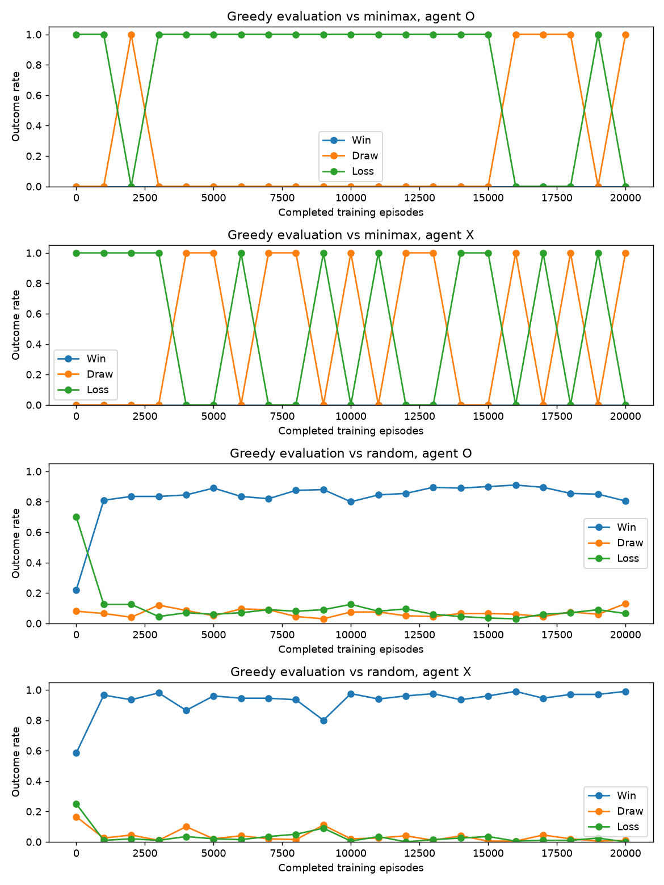

# Reinforcement Learning for Classic Games

[](https://github.com/AMAslam27/Game/actions/workflows/ci.yml)

A Python project exploring reinforcement learning through classic board games,
starting with Tic-Tac-Toe.

The current implementation includes a configurable Deep Q-Network (DQN),
training against random or minimax opponents, evaluation, resumable checkpoints,
and experiment reporting. Self-play and additional games are planned.

## Features

- Tic-Tac-Toe rules and human, random, and minimax players.
- Modular PyTorch networks with dense, dropout, and residual blocks.
- DQN training with experience replay, a target network, and legal-action masking.
- YAML configuration for network architecture and training hyperparameters.
- Configurable optimisers, weight decay, and learning-rate schedulers.
- Evaluation against random and minimax opponents from both player positions.
- Training curves, exploration and learning-rate plots, and timing metrics.
- Saved configurations, checkpoints, and run metadata.

## Getting started

Install dependencies using Poetry:

```sh
poetry install
```

Start training from the repository root:

```sh
poetry run python -m training.tictactoe.train \
  --config training/tictactoe/config.example.yaml
```

Training settings are documented in the
[example configuration](training/tictactoe/config.example.yaml).
Copy it to create a separate experiment configuration.

For a short run:

```sh
poetry run python -m training.tictactoe.train --episodes 1000
```

### Docker

The Compose configuration uses an NVIDIA GPU and requires GPU support in Docker.

```sh
docker compose build
docker compose run --rm tictactoe
```

## Training outputs

Each experiment creates a directory under `training/tictactoe/runs/` containing:

- The resolved configuration and run metadata.
- Episode, decision, update, and evaluation CSV files.
- Model checkpoints and a training log.
- Evaluation game records.
- Plots for returns, outcomes, loss, epsilon, learning rate, and elapsed time.

Resume a run using its checkpoint:

```sh
poetry run python -m training.tictactoe.train \
  --resume training/tictactoe/runs/<run-id>/checkpoints/latest.pt \
  --episodes 30000
```

`--episodes` specifies the total episode target, including episodes already
completed.

## Current results

The first published experiment trained against a random opponent for 20,000
episodes, alternating between X and O.

The latest completed offline assessment, on 15 October 2026, evaluated its
final checkpoint over 12,000 games: 1,000 per opponent, seat, and evaluation
seed. Results pooled across the three evaluation seeds are:

| Evaluation opponent | Agent seat | Games | Wins | Draws | Losses | Loss rate | 95% CI for loss rate |
| --- | --- | ---: | ---: | ---: | ---: | ---: | ---: |
| Random | X | 3,000 | 2,900 | 67 | 33 | 1.10% | 0.78–1.54% |
| Random | O | 3,000 | 2,584 | 289 | 127 | 4.23% | 3.57–5.01% |
| Minimax | X | 3,000 | 0 | 3,000 | 0 | 0.00% | N/A |
| Minimax | O | 3,000 | 0 | 3,000 | 0 | 0.00% | N/A |

The two-sided 95% Wilson confidence intervals estimate sampling uncertainty
against the random opponent for this fixed model, assuming independent games
with a fixed loss probability. They do not estimate variation between training
runs. Intervals are omitted for the deterministic minimax opponent; see the
[uncertainty methodology](docs/offline-evaluation.md#loss-rate-uncertainty).

Evaluation used greedy actions with epsilon set to zero, on CUDA.
Base evaluation seeds were `12345`, `23456`, and `34567`; opponent/seat offsets
are recorded in the [assessment manifest](docs/results/2026-10-15-offline/assessment.json).
The [per-seed results](docs/results/2026-10-15-offline/evaluation.csv) retain all
12 evaluation batches.

- Training run: `20261005T185241722454Z_a1f0bcd3`; training seed: `42`.
- Checkpoint: `episode-00020000_updates-00071783_session-001.pt`.
- Checkpoint SHA-256: `b34b921b7dd3a1aad0cd493993e722129f23bc8239e457e6ea46a21eeb7e628b`.
- Assessment: `2026-10-15_15-43-10_388270_UTC_8965ed0e`.
- Network: two dense hidden layers of 64 units with ReLU activation.
- Optimiser: Adam, with learning rate `0.001`.
- Original training-run device: CUDA.
- Original training-run timings: approximately 183 seconds training,
  71 seconds evaluation, and 294 seconds total elapsed time.

Reproduce this offline assessment with the explicit checkpoint:

```sh
docker compose run --rm --entrypoint python tictactoe -m evaluation.offline_eval --checkpoint training/tictactoe/runs/20261005T185241722454Z_a1f0bcd3/checkpoints/episode-00020000_updates-00071783_session-001.pt --opponents random minimax --seats x o --seeds 12345 23456 34567 --games 1000 --device cuda
```

These results describe three evaluation seeds for one trained model, rather
than independent training runs. Minimax uses deterministic tie-breaking, so
the repeated draws do not prove the model cannot lose against other move
sequences. The original training run recorded uncommitted code changes, so
its recorded Git commit alone does not fully identify the implementation used.

The following chart shows the original evaluations during training, rather
than the expanded offline assessment above.



Inspect the [experiment configuration](docs/results/2026-10-05-random/config.yaml),
[original evaluation results](docs/results/2026-10-05-random/README.md),
[training evaluation history](docs/results/2026-10-05-random/evaluation.csv),
and [complete training plot snapshot](docs/results/2026-10-05-random/).

## Offline checkpoint evaluation

Evaluate a saved model without resuming training:

```sh
poetry run python -m evaluation.offline_eval --checkpoint <checkpoint.pt> --seeds 12345 23456 34567 --games 1000
```

Games are requested per opponent, seat, and evaluation seed. Each assessment
saves independent JSON/CSV summaries and per-game SQLite records. See the
[offline evaluation guide](docs/offline-evaluation.md) for Docker usage,
checkpoint selectors, and interruption behaviour.

## Play Tic-Tac-Toe

```sh
poetry run python runner.py --x human --o minimax
```

Available players are `human`, `random`, `minimax`, and `dqn`.

Play against the best registered saved agent:

```sh
poetry run python runner.py --x human --o dqn --o-agent best
```

Use `--o-agent latest` for the most recently completed available run, or choose
any checkpoint explicitly with `--o-checkpoint <path>`. The corresponding
`--x-agent` and `--x-checkpoint` options support agents as X, including matches
between two different saved models. Models are loaded once and play greedy
legal moves without learning. The resolved experiment, checkpoint path, and
hash are displayed and recorded with match results.

Match charts are generated only for batches with at least two completed games,
including when `--plot-file` is supplied. Displayed project paths are relative
to the project root.

Completed training runs register their final checkpoints automatically in
`results/models.sqlite3`. Import older runs before using automatic selection:

```sh
poetry run python -m evaluation.model_registry training/tictactoe/runs/<run-id>
```

Use `--registry <path>` for a different registry in both training and play,
and `--agent-device cpu` to run saved players on CPU. If eligible models use
different evaluation protocols, select one with `--o-protocol <protocol-id>`
(or `--x-protocol`). The [ranking documentation](docs/model-ranking.md)
explains the criteria and how to inspect protocol IDs.

## Project structure

| Directory | Purpose |
| --- | --- |
| `games/` | Game rules and state |
| `players/` | Baseline players |
| `models/` | PyTorch networks and reusable blocks |
| `training/` | Shared training, evaluation, and experiment utilities |
| `training/tictactoe/` | Tic-Tac-Toe adapter, configuration, and training entrypoint |
| `tests/` | Automated tests |
| `docs/results/` | Published experiment snapshots |

## Development

Run the checks used by CI:

```sh
poetry run ruff check .
poetry run ruff format --check .
poetry run mypy .
poetry run pytest
```

## Planned work

- Evaluate training stability across multiple seeds.
- Add self-play training.
- Extend the environment and training framework to additional games.
