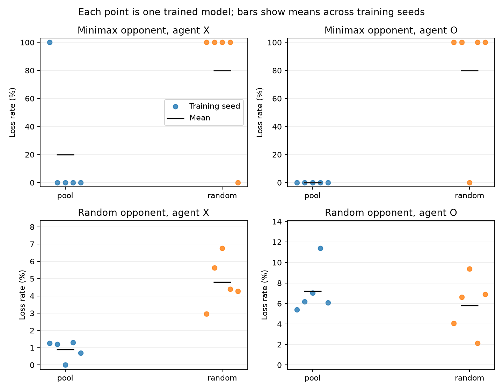

# Tic-Tac-Toe: random training versus snapshot-pool self-play

Ten runs trained on 23 October 2026: five random-opponent baselines and five
snapshot-pool learners, using training seeds 42–46. Every run completed 20,000
episodes with alternating X/O seats, a 64/64 ReLU network, and the same DQN
hyperparameters. Training used CUDA. The pool mixed random/minimax/latest/
historical categories with weights 0.2/0.2/0.3/0.3, froze a snapshot every 1,000
episodes, retained at most eight snapshots, and imported no initial checkpoints.
Unavailable categories were renormalized.

The results show a tradeoff: pool training reduced random-opponent losses as X
and improved results against the tested minimax policy, while increasing average
random-opponent losses as O. It did not reliably learn an unbeatable policy.

## Sampled baseline assessment

Offline evaluation completed on 30 October 2026. Each model played 1,000 games
per opponent (random/minimax), seat (X/O), and evaluation seed
(12345/23456/34567): 12,000 games per model, 120,000 overall. All ten assessments
share protocol `e55f09c71c6a2e4e1b3391fb5b539ff01a4f1390e7f3e12f174f3169eb8bc360`.

| Opponent | Agent seat | Random training mean loss | Pool mean loss | Random training SD | Pool SD |
| --- | --- | ---: | ---: | ---: | ---: |
| Random | X | 4.81% | 0.89% | 1.45 pp | 0.56 pp |
| Random | O | 5.82% | 7.21% | 2.79 pp | 2.41 pp |
| Minimax | X | 80.00% | 20.00% | 44.72 pp | 44.72 pp |
| Minimax | O | 80.00% | 0.00% | 44.72 pp | 0.00 pp |

Means weight the five trained models equally; SD is the sample standard
deviation across training seeds in percentage points. These are descriptive
results from five seeds, not a significance claim. Minimax tie-breaking and
model inference are deterministic: repeated minimax games duplicate a single
trajectory for each model/seat, rather than 3,000 independent tests of robustness.
Four pool models drew against minimax from both seats; no baseline model did.



[models.csv](models.csv) contains every model's counts and Wilson intervals
against random play; [training-seeds.csv](training-seeds.csv) contains the
aggregates. Per-model sampling intervals must not be interpreted as uncertainty
across training seeds. The original [assessment manifests](assessments/) include
full resolved training configurations, checkpoint hashes, seeds, and runtimes.

## Exhaustive assessment

Every legal opponent response was explored against each model's greedy policy
from the empty board, in both seats. Only **pool seed 44 as X** had no losing
continuation (123 winning terminal sequences, 10 drawing sequences, no losses).
Every other model/seat was exploitable, including all ten O policies.

| Training method | Seed | Unbeatable as X | Unbeatable as O |
| --- | ---: | --- | --- |
| Random | 42 | No | No |
| Random | 43 | No | No |
| Random | 44 | No | No |
| Random | 45 | No | No |
| Random | 46 | No | No |
| Pool | 42 | No | No |
| Pool | 43 | No | No |
| Pool | 44 | Yes | No |
| Pool | 45 | No | No |
| Pool | 46 | No | No |

The seed-44 checkpoint hash is
`dbdbb6eeb7dc496ded7c9092cf7f738830e52956007cd377eda75d4b82e46cfc`.
Its O counterexample is `[0, 4, 8, 2, 6, 7, 3]`, using zero-based row-major
squares and alternating X/O moves. The opponent X wins with squares 0, 3, 6.

[exhaustive.csv](exhaustive.csv) contains terminal path counts, distinct state
counts, and a replayable losing sequence for every exploitable seat.
[exhaustive.json](exhaustive.json) records identities and runtime. Terminal-path
counts are not random-play probabilities. The guarantee applies to the exact
policy, empty-board start, and recorded device/software.

## Historical references

The two fixed references predate these ten runs:

| Reference run | Training | Checkpoint SHA-256 |
| --- | --- | --- |
| `20261005T185241722454Z_a1f0bcd3` | Random, seed 42 | `b34b921b7dd3a1aad0cd493993e722129f23bc8239e457e6ea46a21eeb7e628b` |
| `20261016T172001266503Z_60cb62f5` | Pool, seed 42 | `c08da0db7ace358665f9a92a7febc158a0debc84273476e84c2d865363f6c254` |

Each candidate played each reference once from each seat: 40 deterministic
matchups overall. Across the 20 matchups per method:

| Training method | Wins | Draws | Losses |
| --- | ---: | ---: | ---: |
| Random | 6 | 7 | 7 |
| Pool | 4 | 12 | 4 |

Pool models lost fewer matchups but also won fewer. This small, fixed reference
set is diagnostic evidence, not a general strength estimate. References share
some training settings and seeds with candidates; there is no held-out-population
claim. Exact participants, outcomes, and move sequences are in
[historical.csv](historical.csv) and [historical.json](historical.json).

## Reproduction

The training runs recorded source commit
`173790a75529b8d46c1f79a3cead530fbce085ab`. Their manifests could not check
working-tree cleanliness because Git was unavailable inside the container.
Thus the commit alone is not a complete source provenance guarantee.
Offline baseline assessments used Python 3.12.15 and PyTorch 2.14.1+cu130.
Exhaustive/historical evaluation used Python 3.14.6 and PyTorch 2.14.1+cu130
on an NVIDIA GeForce RTX 5060 Laptop GPU; exact versions are in the manifests.
The evaluation commands were run from the repository containing this evaluator.
Model checkpoints remain local and are not included in Git.

The [configs](configs/) directory contains the ten original input YAML files;
the assessment manifests retain their resolved defaults. To repeat training,
use a matching source checkout and run, for each configuration:

```sh
docker compose run --rm training --config docs/results/2026-10-30-comparison/configs/config.random.seed-42.yaml --episodes 20000
```

For the existing exact checkpoints, the following PowerShell prepares all inputs
from the published identities rather than selecting whichever model is latest:

```powershell
$published = "docs/results/2026-10-30-comparison"
$evidence = Get-Content "$published/exhaustive.json" -Raw | ConvertFrom-Json
$history = Get-Content "$published/historical.json" -Raw | ConvertFrom-Json

function Resolve-LocalCheckpoint($model) {
    $filename = ($model.checkpoint_path -split '[/\\]')[-1]
    $path = "training/tictactoe/runs/$($model.run_id)/checkpoints/$filename"
    if ((Get-FileHash -LiteralPath $path -Algorithm SHA256).Hash.ToLowerInvariant() -ne $model.checkpoint_hash) {
        throw "Checkpoint identity mismatch: $path"
    }
    return $path
}

$checkpoints = @($evidence.models | ForEach-Object { Resolve-LocalCheckpoint $_ })
$references = @($history.references | ForEach-Object { Resolve-LocalCheckpoint $_ })
```

Repeat the sampled baseline assessments if needed (this writes new assessment
directories and plays another 120,000 games):

```powershell
foreach ($checkpoint in $checkpoints) {
    docker compose run --rm --entrypoint python tictactoe -m evaluation.offline_eval --checkpoint $checkpoint --opponents random minimax --seats x o --seeds 12345 23456 34567 --games 1000 --device cuda
    if ($LASTEXITCODE -ne 0) { throw "Offline evaluation failed" }
}
```

Run the additional checks with the same fixed checkpoints. Change output names
when repeating; each output directory must be new:

```powershell
poetry run python -m evaluation.exhaustive --checkpoints $checkpoints --device cuda --output results/tictactoe/exhaustive/reproduction
if ($LASTEXITCODE -ne 0) { throw "Exhaustive evaluation failed" }
poetry run python -m evaluation.historical --checkpoints $checkpoints --references $references --device cuda --output results/tictactoe/historical/reproduction
if ($LASTEXITCODE -ne 0) { throw "Historical evaluation failed" }

$assessments = @(Get-ChildItem "$published/assessments/*.json" | ForEach-Object { $_.FullName })
poetry run python -m evaluation.comparison_report --assessments $assessments --historical results/tictactoe/historical/reproduction/historical.json --exhaustive results/tictactoe/exhaustive/reproduction/exhaustive.json --output results/tictactoe/reports/reproduction
```

To regenerate only the report, supply the published `historical.json` and
`exhaustive.json` instead. This requires no checkpoint files. See the
[assessment guide](../../policy-assessment.md) for output semantics and limitations.

This closes the planned tic-tac-toe self-play experiment with documented
limitations. Improving training to produce consistently unbeatable models
remains optional future work.
